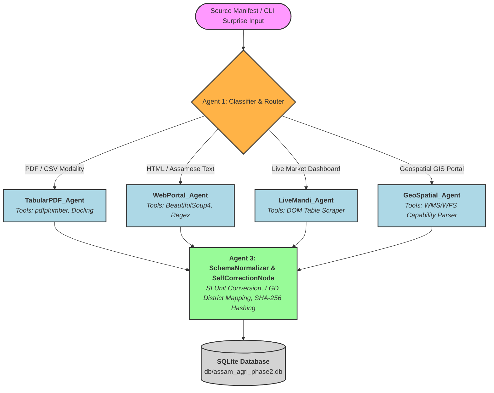

# AgriAgent Phase 2: System Architecture, Multi-Agent Pipeline & Database Documentation

This document provides a comprehensive technical breakdown of the multi-agent agricultural data pipeline for Assam, detailing the agent responsibilities, execution flows, normalization logic, and database schematics.

---

## 1. Multi-Agent System Architecture

To eliminate single-point-of-failure bottlenecks and handle heterogeneous data modalities (PDFs, web portals, live dashboards, and geospatial geoportals), the pipeline is decentralized into **4 independent specialist agents** orchestrated by a centralized state router (`Agent1Classifier`), with downstream validation managed by `Agent3TaskNormalizer`.



---

## 2. Specialist Agent Responsibilities & Tooling

### Module 1: `agent1_classifier.py` (`Agent1Classifier`)
* **Role:** Supervisor Router & Modality Classifier.
* **Responsibilities:** Inspects file extensions (`.pdf`, `.html`, `.csv`, `.json`, `.txt`), magic bytes, URL signatures (`.gov.in`), and UTF-8 Assamese Unicode ranges (`\u0980`–`\u09FF`). Dynamically routes workloads to the correct specialist worker module and configures the exact tool arguments without fragile LLM calls.

### Module 2: `agent2_ingestion.py` (`Agent2Ingestion` & `AISemanticExtractor`)
* **Roles:** `TabularPDF_Agent` & `WebPortal_Agent`.
* **Responsibilities:** 
  * **Deterministic Layer:** Uses `pdfplumber` to extract multi-row hierarchical table grids from state government PDFs, and `BeautifulSoup4` to parse semi-structured HTML tables.
  * **AI Semantic Layer (Qwen-2.5-72B + QLoRA Adapter):** Resolves split table headers, filters national ICAR registries for Assam-specific entries, and transliterates regional Assamese Unicode (*'শালি ধান'*, *'ৰঞ্জিত চাব-১'*) into canonical Pydantic schema attributes.

### Module 3: `agent2b_live_gis.py` (`Agent2BLiveGIS`)
* **Roles:** `LiveMandi_Agent` & `GeoSpatial_Agent`.
* **Responsibilities:**
  * **`LiveMandi_Agent` (`Database_Dashboard`):** Scrapes rolling commodity arrival and modal price series (`Rs/Quintal`) from AMIU Jorhat dashboards.
  * **`GeoSpatial_Agent` (`Geospatial_GIS`):** Extracts Web-GIS layer metadata, spatial resolution in meters, temporal coverage, and soil pH ratings from remote sensing geoportals.

### Module 4: `agent3_task.py` (`Agent3TaskNormalizer`)
* **Roles:** `SchemaNormalizer_Agent` & `SelfCorrectionNode`.
* **Responsibilities:**
  * **Self-Correction:** Detects footnote markers (`*`) and corrupted floating-point cells (`CORRUPT_NaN_99,400*`), stripping garbage tokens and incrementing retry counters.
  * **LGD District Canonicalization:** Maps 35+ historical and Assamese district spellings (*Sibsagar*, *Nowgong*, *কামৰূপ*) to official Local Government Directory codes (`LGD_AS_300`, `LGD_AS_297`, `LGD_AS_291`).
  * **SI Unit Standardization:** Converts heterogeneous units into strict SI bases (`q/ha` $\rightarrow$ `kg/ha`, `Rs. Lakh` $\rightarrow$ `INR`, `Hectares` $\rightarrow$ `ha`, `Tonnes` $\rightarrow$ `tonnes`).
  * **Idempotent Hashing:** Generates a 24-character SHA-256 `record_hash` based on natural keys (`source_id`, `locator`, `crop_id`, `location_id`, `time_period`, `metric_name`) to prevent duplicate database insertions.

---

## 3. Database Schema (`db/schema.sql`)

The final data warehouse is structured into normalized dimension tables and an idempotent fact table:

1. **`dim_sources`**: Stores metadata for all 15 agricultural sources + surprise ingestion channels (`source_id`, `source_name`, `url`, `source_group`, `period`, `assigned_agent`, `status`).
2. **`dim_locations`**: Maps canonical district names and agro-climatic zones to official LGD codes (`location_id` PK, e.g., `LGD_AS_300`).
3. **`dim_crops`**: Identifies crops and varieties via MD5 hashes (`crop_id` PK, `crop_name`, `variety_name`).
4. **`extraction_runs`**: Logs execution telemetry, latency in milliseconds, token usage, and retry counts per pipeline run (`run_id` PK).
5. **`fact_agricultural_records`**: Central fact table storing normalized metrics (`record_hash` PK, `source_id`, `extracting_agent`, `source_location`, `location_id`, `crop_id`, `time_period`, `metric_name`, `raw_value_text`, `raw_unit`, `normalized_value`, `normalized_unit`, `validation_status`).

---

## 4. End-to-End Workflow & Execution Guide

### 1. Running the Standard Evaluation Benchmark
To run the held-out 32 evaluation cases and compute all 18 metrics (`M1`–`M18` + Bonus):
```bash
python eval/run_eval.py
```

### 2. Testing Unseen Surprise Inputs (CSV, HTML, PDF)
To ingest and validate arbitrary surprise files dropped into `my_surprise_test/`:
```bash
python run.py --input my_surprise_test/
```

### 3. Testing Fault Injection & Self-Recovery
To trigger the automated fault injection test that simulates a corrupted token (`CORRUPT_NaN_99,400*`) and recovers via `SelfCorrectionNode`:
```bash
python run.py --inject-fault
```

### 4. Inspecting Provenance and Database Records
To query committed records directly from SQLite:
```bash
python -c "import sqlite3; conn=sqlite3.connect('db/assam_agri_phase2.db'); [print(r) for r in conn.execute('SELECT record_id, source_id, extracting_agent, source_location, metric_name, normalized_value, normalized_unit FROM fact_agricultural_records LIMIT 5')]"
```